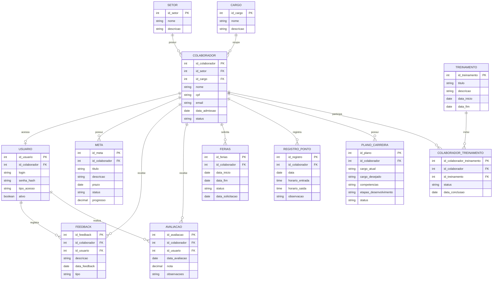

# Estrutura do banco de dados — Evolut

## Objetivo
O banco de dados foi planejado para centralizar informações de usuários, colaboradores e processos de Recursos Humanos: metas, avaliações, feedbacks, treinamentos, plano de carreira, férias e registro de ponto.

> **Atenção:** este é o modelo lógico proposto para documentar a Sprint 2. Os nomes e campos devem corresponder ao banco realmente implementado pelo grupo. Se o código de vocês usar nomes diferentes, ajustem o diagrama para manter a documentação fiel ao sistema.

## Diagrama entidade-relacionamento (DER)

## Descrição das entidades

| Entidade | Finalidade |
|---|---|
| `USUARIO` | Armazena as credenciais e o tipo de acesso ao sistema. |
| `COLABORADOR` | Guarda os dados cadastrais dos funcionários. |
| `SETOR` | Organiza os colaboradores por departamento. |
| `CARGO` | Registra os cargos existentes na empresa. |
| `META` | Permite cadastrar e acompanhar objetivos dos colaboradores. |
| `FEEDBACK` | Registra comentários e orientações recebidos pelos colaboradores. |
| `AVALIACAO` | Armazena avaliações de desempenho. |
| `TREINAMENTO` | Mantém o catálogo de treinamentos disponíveis. |
| `COLABORADOR_TREINAMENTO` | Relaciona colaboradores aos treinamentos e acompanha sua participação. |
| `FERIAS` | Registra solicitações e períodos de férias. |
| `REGISTRO_PONTO` | Armazena horários de entrada e saída. |
| `PLANO_CARREIRA` | Registra objetivos e etapas de desenvolvimento profissional. |

## Relacionamentos principais
- Um setor pode possuir vários colaboradores; cada colaborador está associado a um setor.
- Um cargo pode ser ocupado por vários colaboradores.
- Um colaborador pode ter uma conta de usuário para acessar o sistema.
- Um colaborador pode possuir várias metas, avaliações, solicitações de férias e registros de ponto.
- Um feedback é associado ao colaborador que o recebe e ao usuário que o registra.
- Um treinamento pode ter vários colaboradores, e um colaborador pode participar de vários treinamentos. A tabela `COLABORADOR_TREINAMENTO` representa essa relação.
- Um colaborador pode possuir um ou mais registros de plano de carreira.

## Regras e cuidados
- As chaves `PK` identificam exclusivamente cada registro.
- As chaves `FK` conectam registros de tabelas diferentes.
- A senha deve ser armazenada como hash, nunca em texto puro.
- O tipo de acesso deve controlar quais funcionalidades cada usuário pode utilizar.
- Campos obrigatórios, validações e regras de exclusão devem ser definidos na implementação do banco.
